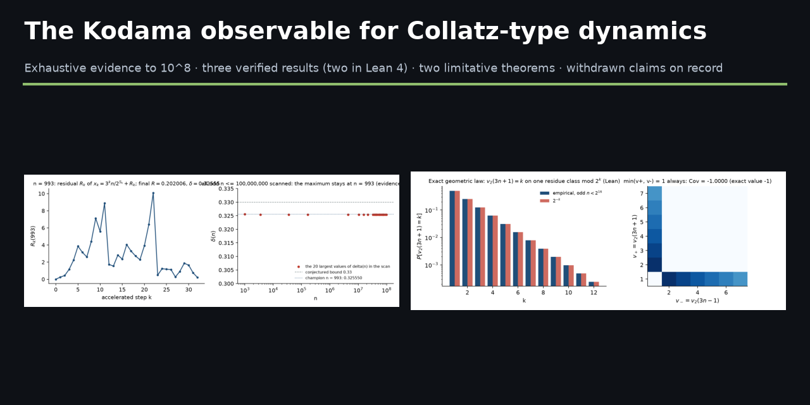
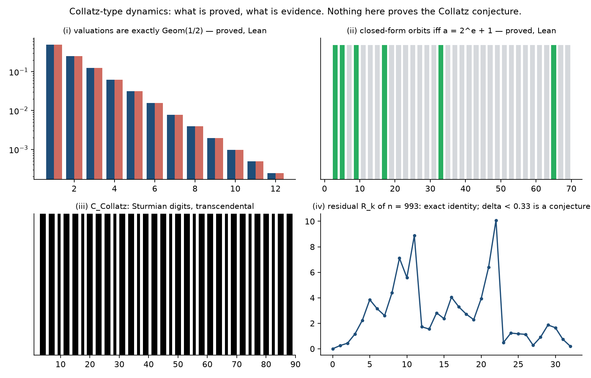
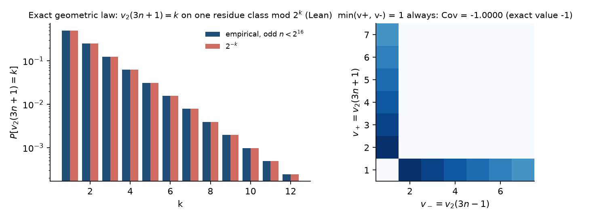
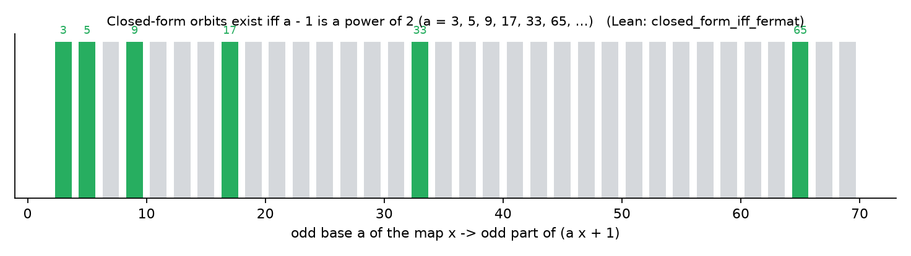
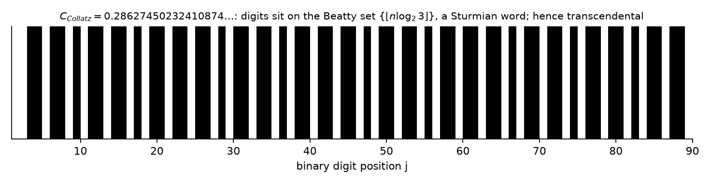
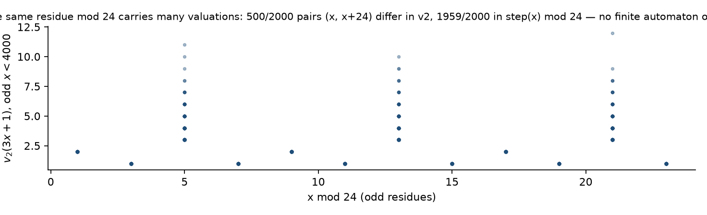
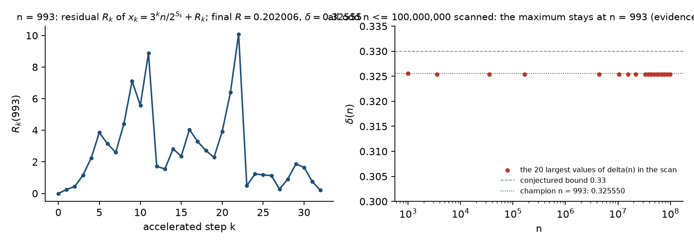

# The Kodama observable for Collatz-type dynamics



This repository publishes, in full and with its verification, a research campaign on the
accelerated Collatz map `step(x) = (3x + 1) / 2^{v₂(3x+1)}` conducted in 2026 by
Joel Cruz Cabrera with substantial AI assistance. It contains the papers, the Lean 4 proofs,
the reproduction scripts, the exploration catalog — and an explicit account of what was
claimed earlier and has since been withdrawn.

**The one-sentence summary:** nothing here proves the Collatz conjecture. What is here is
(a) three exact, unconditional results that arise from the map but do not depend on the
conjecture, two of them machine-checked; (b) an unconditional structural note about the map,
including two *limitative* theorems that show what a whole family of approaches cannot do;
(c) an exact identity — the *Kodama observable* — together with a conjecture about it that is
supported by exhaustive computation to 10⁸ and is **not** proved.

## What is proved

| Result | Where | Status |
|---|---|---|
| **Exact 2-adic law:** `v₂(a n + 1) ≥ k ⟺ n ≡ −a⁻¹ (mod 2ᵏ)` for every odd base `a`; hence `v₂(3n+1)` is `Geom(1/2)` on uniform odd residues, with mean 2 and variance 2, and `Cov(v₂(3n+1), v₂(3n−1)) = −1` exactly. | `papers/three-exact-results` §2, `papers/geometric-law` | Proved; `geometric_distribution_informal`, `unique_inverse_mod`, `modular_solution_odd` in Lean (`lean/CollatzProof/KodamaCollatz.lean`). |
| **Fermat-type bases:** `x ↦ odd part of (a x + 1)` has closed-form orbits `⟺ a − 1` is a power of 2. The one-step law `v₂(ax+1) = e`, `step_a(2^{r+1}m − 1) = a·2^{r+1−e}m − q` holds for every odd `a`. | §3, `papers/fermat-bases` | Proved; both directions in Lean (`step_a_general`, `closed_form_iff_fermat`, `fermat_iff_pow_two`, `orbit_formula_fermat` in `KodamaFermat.lean`). |
| **A transcendental constant:** `C_Collatz = ½ − Σ_{n≥2} 2^{−⌊n log₂3⌋} = 0.28627450232410874…` has a Sturmian binary expansion and is transcendental (Ferenczi–Mauduit / Adamczewski–Bugeaud). | §4, `papers/transcendence` | Proved via known criteria; digits and complexity recomputed exactly. |
| **No finite-residue reduction:** for **no** modulus `M` is `v₂(3x+1)` a function of `x mod M`. | §5 of both papers | Proved, with explicit witnesses (at `M = 24`: 500 of 2000 pairs `(x, x+24)` differ in `v₂`, 1959 in `step(x) mod 24`). |
| **Exact orbit identity and logarithmic defect:** `2^S = 3^A n + Σ 3^{A−1−i} 2^{S_i}`, and `δ := S − A log₂3 − log₂n = Σ log₂(1 + 1/(3aᵢ)) > 0`. | `papers/structure-note` §4 | Proved (elementary; the `δ` identity is one telescoping sum). |
| **Predecessor law mod 3, last-pair parity, run-length law, 2-adic resistance descent.** | structure note §2–4 | Proved. |
| **Descent atlas:** 197 residue classes `n ≡ r (mod 2ʲ)` on which the orbit provably drops below `n` within `t` steps — 1398 theorems auto-formalized by orbit unrolling. | `lean/CollatzProof/MicroscopeDescent.lean` | Machine-checked, no `sorry`, kernel axioms only (sampled in `AxiomAudit.lean`). |
| **The ceiling:** descent-class enumeration covers a set of density `1 − ρ(j) → 1` but never all `n`; with the previous item, **no finite enumeration of residue classes can prove the conjecture**. | structure note §7 | Proved. |
| **Althöfer's game `3n ± 1` (Prize 3):** the game has *no* 2-adic structure — 0 pure classes mod `2ʲ` for `j ≤ 12`, LOSE positions equidistributed. | `papers/althofer-prize3` | Negative computational result, exact; `verify_prize3.py`. |

Every "Lean" entry above reports exactly `[propext, Classical.choice, Quot.sound]` under
`#print axioms` (`lean/CollatzProof/AxiomAudit.lean`).

## The Kodama observable, and what is *not* proved

Along the orbit `x₀ = n, x_{k+1} = step(x_k)` with valuations `v_k`, define `R₀ = 0`,
`R_{k+1} = (3R_k + 1)/2^{v_{k+1}}`. Then — exactly —

```
x_k = 3^k n / 2^{S_k} + R_k,        R_K = 1 − 3^K n / 2^S  when x_K = 1,
δ(n) = −log₂(1 − R_K) = Σ_{x_i > 1} log₂(1 + 1/(3 x_i)).
```

`R_k` is the *residual* of the orbit around its geometric main term; `δ(n)` is the
logarithmic defect. Both identities are proved (structure note, Prop. 4.1–4.2) and re-checked
by `scripts/make_figures.py` and `scripts/kodama_scan.py`.

**Conjecture (champion).** `δ(n) < 0.33` for every odd `n > 1`, equivalently `R(n) < 0.2021`,
with the maximum attained at `n = 993` (`δ = 0.325550…`, `R = 465793961683815839 / 2⁶¹ = 0.202006…`).

**Evidence.** `scripts/kodama_scan.py` scans every odd `n ≤ 10⁸` (≈9 min on 8 cores; results
in `data/kodama_scan_100000000.json`): the maximum is `n = 993`, and the next values form a
plateau at `δ = 0.325377` (`n = 167211, 21945135, 32917703, 78027147, 87780541, …`). **Every
comparison in the scan is an integer comparison** on `R(n) = (2^S − 3^K n)/2^S` (champion,
plateau order, histogram bins, threshold); `δ` is computed in floating point only for display.
Until 15-Sep-2026 the scan compared `δ` as a double — same champion, same plateau, same
histogram, verified by re-running both — but the verdict of a repository called *exact* should
not rest on floating point, and now it does not. This is
a finite computation. It supports the conjecture and proves nothing beyond `10⁸`. Earlier
documents of this project stated the bound as a theorem; see **Withdrawn claims** below.



## Withdrawn claims — read this

Earlier outputs of this project — the Zenodo preprint *The Kodama Observable for Collatz
Dynamics* ([10.5281/zenodo.21087140](https://zenodo.org/doi/10.5281/zenodo.21087140), July
2026), the then-private repository `kodama-observable`, and several draft manuscripts — claimed
or implied that the Collatz conjecture had been proved, via (1) a "finite automaton mod 24",
(2) the "structural bound `δ(n) < 0.33`", (3) an implication "`R_k < ½` ⟹ convergence".
**All three are withdrawn.** (1) is refuted by the no-finite-residue theorem above, proved in
this very repository; (2) is a conjecture supported to `10⁸`, not a theorem; (3) is not a
theorem either. The full account, with what each claim rested on and why it fails, is in
[docs/withdrawn-claims.md](docs/withdrawn-claims.md). The Zenodo record is left as it is,
for the record; this repository supersedes it.

## Papers

| Folder | Title | Notes |
|---|---|---|
| `papers/three-exact-results` | *Three Exact Results Arising from Collatz-Type Dynamics: Valuation Equidistribution, Fermat Bases, and a Transcendental Density Constant* (7 pp) | Submitted to *Experimental Mathematics* (Taylor & Francis, ms. 261387702, July 2026); **declined**. `verify.py` regenerates every number in it. |
| `papers/structure-note` | *Exact Structure in Accelerated Collatz Dynamics: Valuation Laws, Orbit Identities, and a Machine-Certified Descent Atlas* (5 pp) | Unconditional structure of the map; two limitative results; the champion stated as a conjecture. |
| `papers/geometric-law`, `papers/fermat-bases`, `papers/transcendence` | one short paper per independent result | self-contained |
| `papers/althofer-prize3` | *The game `3n ± 1` has no 2-adic structure* (3 pp) | Negative result for Althöfer's Prize 3; `verify_prize3.py`. |

## Figures

Generated by `scripts/make_figures.py`; each figure recomputes the statement it illustrates
and asserts it before drawing.

| | |
|---|---|
|  |  |
|  |  |
|  | |

## Reproducing

```bash
python papers/three-exact-results/verify.py        # every number of the main paper, [OK]/[FAIL]
python papers/althofer-prize3/verify_prize3.py       # the Prize-3 counts
python scripts/kodama_scan.py 100000000 8            # the 10^8 scan, exact integer comparisons (~9 min on 8 cores)
python scripts/make_figures.py                       # the figures, with their internal checks
cd lean && lake exe cache get && lake build          # the Lean proofs; AxiomAudit prints the axioms
```

The Lean project pins `leanprover/lean4:v4.32.0-rc1` and Mathlib at that tag. Only the files
cited by the papers are shipped (`KodamaCollatz`, `KodamaFermat`, `MicroscopeDescent`,
`AxiomAudit`); the campaign's other Lean files — exploratory, several with `sorry`, some
stating the full conjecture — are deliberately **not** included.

## Catalog

`catalog/` holds the raw exploration records (JSON) of the Collatz line of the campaign,
including the refuted candidates; `docs/catalog.md` renders them with their status. Refuted
entries are kept on purpose: they are part of the evidence for how the accepted results were
reached, and against the claims that were withdrawn.

## How this was produced

Directed by Joel Cruz Cabrera. The Lean code, the scripts and most of the prose were written
with an AI assistant (Claude, Anthropic); every theorem was accepted only when the Lean kernel
accepted it, every number only when an exact reproduction script printed it, and every
candidate that failed either test was discarded — including the ones that had already been
announced, which is why the withdrawn-claims document exists.

## License

Apache 2.0 for code and Lean sources; the papers are © the author, shared here for reading
and verification.
