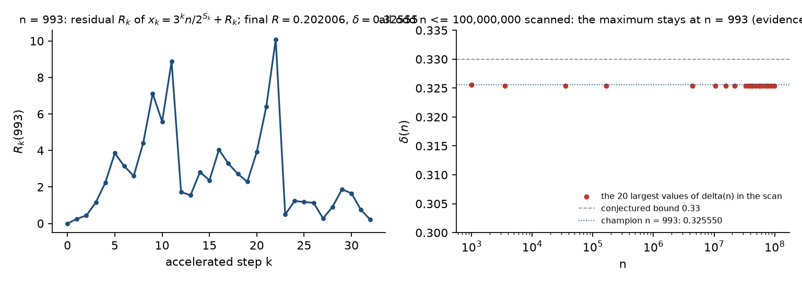

# The Kodama observable: exact decomposition, residual dynamics, evidence to 10⁸

## Definitions

For odd `n`, the accelerated orbit is `x₀ = n`, `x_{k+1} = (3x_k + 1)/2^{v_{k+1}}` with
`v_{k+1} = v₂(3x_k + 1)`. Let `S_k = v₁ + ⋯ + v_k`.

**Residual.** `R₀ = 0`, `R_{k+1} = (3R_k + 1)/2^{v_{k+1}}`.

**Exact decomposition** (structure note, Prop. 4.1, "exact orbit identity", rewritten): for every `k`,

```
x_k = 3^k · n / 2^{S_k} + R_k .
```

*Proof.* Induction: `x_{k+1} = (3x_k + 1)/2^{v} = (3·3^k n/2^{S_k} + 3R_k + 1)/2^{v} = 3^{k+1} n/2^{S_{k+1}} + R_{k+1}`. ∎

So `R_k` is exactly the part of `x_k` not explained by the geometric main term
`3^k n / 2^{S_k}`; it is the accumulated effect of the `+1`s. If the orbit reaches `1` after
`K` odd steps, with `S = S_K`, then

```
R_K = 1 − 3^K n / 2^S ,      δ(n) := S − K log₂3 − log₂ n = −log₂(1 − R_K) .
```

**Logarithmic defect as a sum** (structure note, Prop. 4.2): taking `log₂` of
`2^{v_{i+1}} x_{i+1} = 3x_i (1 + 1/(3x_i))` and summing over the orbit, the `log₂ x_i`
telescope and

```
δ(n) = Σ_{i=0}^{K−1} log₂(1 + 1/(3 x_i))  > 0 .
```

Both identities are checked exactly (rationals) for `n = 993` in `scripts/make_figures.py`, and
the decomposition is what `scripts/kodama_scan.py` uses.

## What the identities do and do not give

They are unconditional as identities, but the terminal forms (`R_K`, `δ(n)`) only make sense
for orbits that terminate — they *assume* the conjecture for that `n`. They cannot therefore be
used to prove it. What they give is an exact, orbit-level quantity that can be tabulated and
whose extremal behaviour can be conjectured.

## The champion conjecture

> For every odd `n > 1`, `δ(n) < 0.33` (equivalently `R(n) < 0.2021`); the maximum over all
> odd `n ≥ 3` is attained at `n = 993` and its doublings.

`δ(993) = 0.325550…`, `R(993) = 465793961683815839 / 2⁶¹ = 0.202006…`, with `K = 32`, `S = 61`.

The structure note (§8) phrases the champion statement with `sup_k R_k` along the orbit rather
than the terminal value; the numbers reported in every document (`0.202006`) are the terminal
value, which is the reading we adopt here and the one the scan supports. Along the orbit `R_k`
is not small at all (for `n = 993` it exceeds `10` near step 22); it is the terminal residual
that is bounded in the data.

## Evidence: every odd n ≤ 10⁸

`python scripts/kodama_scan.py 100000000 8` — 50,000,000 odd starts, exact integer orbits,
50 s on an 8-core M2. Output in `data/kodama_scan_100000000.json`.

| range | maximum of δ | at n |
|---|---|---|
| all odd `n ≤ 10⁸` | **0.325550** | **993** |
| next largest | 0.325414 | 3531 |
| | 0.325380 | 35271 |
| plateau | 0.325377 | 167211, 21945135, 32917703, 78027147, 87780541, 99892307, … |

The plateau at `0.325377` is a family of starts sharing a long common tail with a slightly
smaller `δ` than 993; no start in the range comes within `0.0001` of the conjectured bound
`0.33`, and the maximum does not move after `n = 993`. Earlier project documents report the same
champion to `10⁹`.



This is what "experimental evidence up to 10⁸" means: an exhaustive finite check, reproducible
in a minute, consistent with the conjecture — and silent about `n > 10⁸`.

## Relation to the withdrawn "structural bound"

An earlier draft decomposed the sum `Σ log₂(1 + 1/(3x_i))` into the contribution of the
orbit's small terminal terms ("suffix"), of medium terms ("transient") and of large terms
("huge"), bounded each piece heuristically, and announced `δ(n) < 0.33` as a theorem. The
decomposition is fine; the bounds on the pieces were not proved for all orbits, and the
whole construction presupposes termination. It is recorded in `docs/withdrawn-claims.md`.
